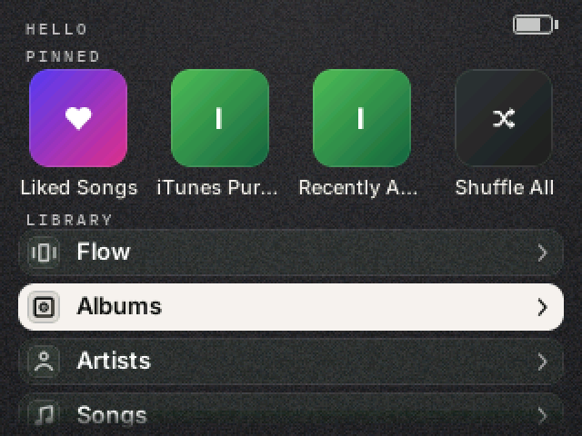
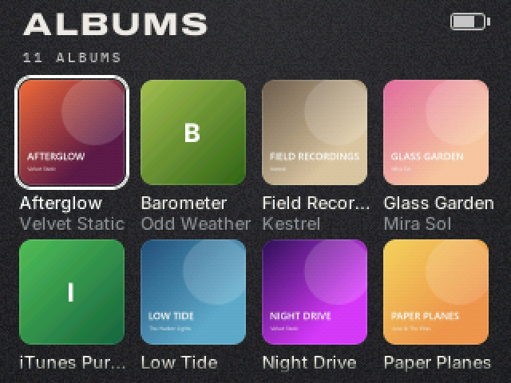
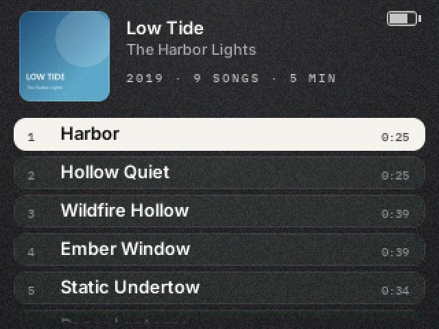
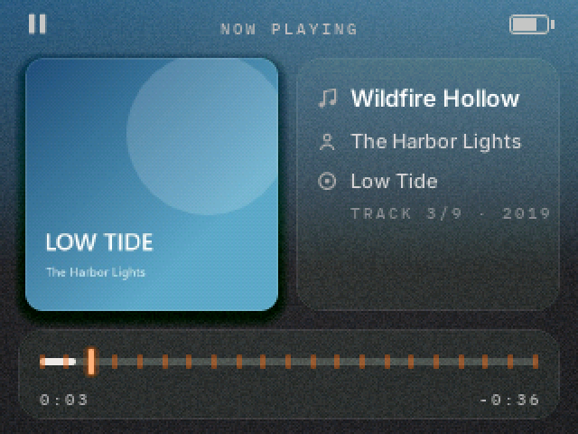
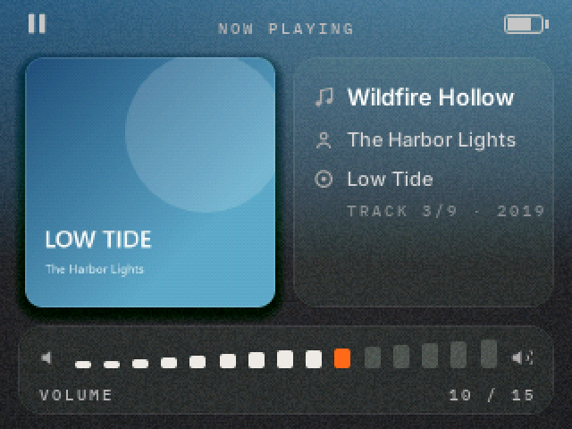
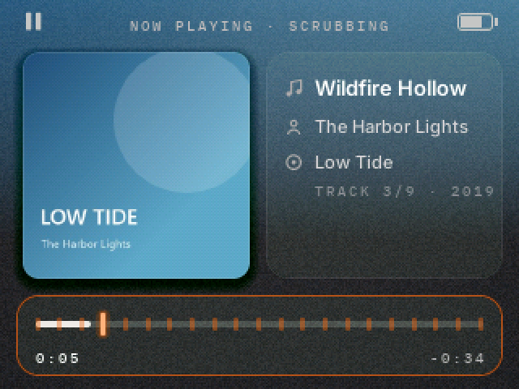
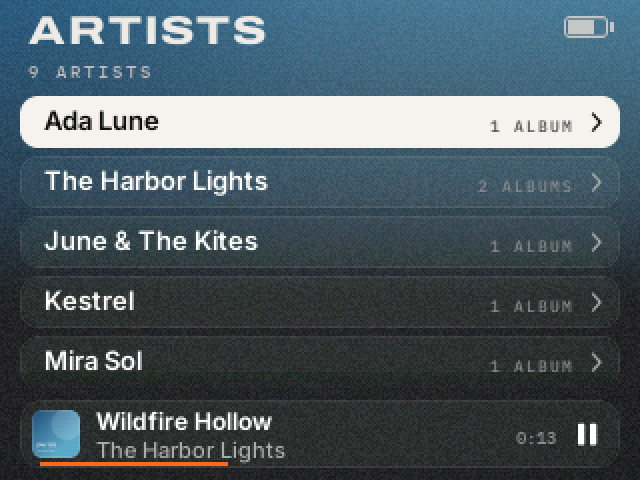
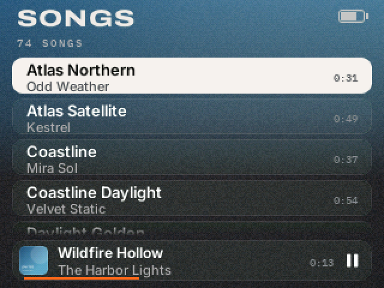
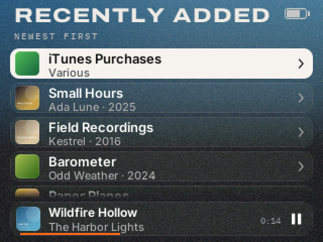

# Knurl firmware for the iPod Video (5th gen)

A hand-rolled firmware for the iPod Video: PortalPlayer PP5022, Broadcom BCM2722 video chip, Wolfson
WM8758 codec, here with a flash card (iFlash) in place of the hard drive. It has the look of the
[Knurl Android app](https://github.com/akbyrner/knurl).

It is not built on Rockbox. Rockbox's source was used as hardware documentation only, and isn't part of this
repository. Knurl is installed alongside Apple's firmware, with its own boot loader; nothing else is needed
on the iPod.

<p>
  
  
  
  
  
  
  
  
  
</p>

These screenshots come from the simulator running the real app code against a demo disk image
(`./build.sh shots`). `docs/images/sheet.png` shows the whole scripted walk.

## What it does

- **Library**:
  - Home has a Pinned shelf: Liked Songs, last played album, Recently Added, Shuffle All.
  - Albums grid, album page, Artists, artist page, Songs, Recently Added.
  - Covers, plus a blurred "wash" of the playing cover behind everything.
- **Playback**: gapless MP3 (MPEG-1 Layer III) from a fixed-point decoder running on the second ARM core.
  - Now Playing has a 21-notch scrub bar.
  - The wheel sets the volume (16 steps); Select switches the wheel to scrubbing.
- **Power**:
  - Backlight off after 20 s.
  - The CPU sleeps between events.
  - Battery gauge and charging indicator.
  - Off after holding PLAY for 2 s, after 15 min idle, or when the battery is flat.
- **Disk mode inside Knurl**: plug in with HOLD on and the iPod is a USB 2.0 high-speed drive. Reads
  run at about 14 MB/s and writes at about 6.5 MB/s.
- **HOLD** locks the buttons.
- **Battery log**: a sample every minute, so the battery curve can be fitted to the real cell.

The music and its index come from [PodManager](https://github.com/akbyrner/PodManager), a Windows app.
It copies MP3s into `\Music` and writes the library index Knurl reads (`/.knurl/library.bin`, `art.bin`),
so there is no tag parsing or image decoding on the iPod.

## How it boots

Knurl's boot loader (`firmware/boot/`, `build/knurlboot.ipod`, 6 KB) sits in the iPod's firmware partition,
appended to Apple's firmware. The boot ROM loads that image into SDRAM and starts the loader, which decides:

- **HOLD on** while it starts: Apple's firmware.
- Otherwise it loads `/.knurl/knurl.ipod` from the music partition, checks it, copies it to `0x10000000`,
  and both ARM cores jump there.
- If that file is missing or bad, it shows a red line on a graphite screen for 3 s, then starts Apple's
  firmware.
- A broken build can't brick anything. Apple's disk mode (restart with MENU+SELECT, then hold
  **Select + Play**) lives in ROM, so the file can always be put back from a PC.

**Installing a new Knurl:**

1. Slide HOLD on and plug the iPod in, so it shows up in Knurl's disk mode.
2. Copy `firmware/build/knurl.ipod` to `<iPod>\.knurl\knurl.ipod`.
3. Eject the iPod and slide HOLD off.

**Installing the loader:** Knurl writes the loader itself (`device/fwinstall.c`).

- It only installs a loader that has already started this exact Knurl, which proves the loader works
  before it goes into the firmware partition. The loader leaves a stamp in RAM with its checksum, and
  Knurl checks it.
- The first install ran under another loader (Rockbox's):
  1. It started `knurlboot.ipod`.
  2. That loader started Knurl.
  3. Knurl found `/.knurl/knurlboot.ipod`, checked the partition layout, wrote the loader and the
     directory entry, read both back, and restarted through it.
- To test a different loader now, first try it on a copy of the firmware partition (an iTunes restore plus
  ipodpatcher, or Apple's disk mode plus ipodpatcher).
- A refusal or an install is reported in `/.knurl/install.log`. Every boot shows which loader ran.

Knurl never writes the FAT. The PC creates the files Knurl writes into, zero-filled at full size, and Knurl
overwrites their sectors in place (`device/store.c`). These files are `battery.log` (created by PodManager)
and `install.log`.

File format (`tools/mkipod.py`): big-endian checksum, `ipvd`, image. Checksum = 5 + the sum of the image bytes.

## Build

Needs Docker. The toolchain image (`toolchain/Dockerfile`) has arm-none-eabi GCC, Python with Pillow,
dosfstools and mtools, plus an ARM Linux cross-compiler and qemu-user for the decoder checks.
`tools/mp3check.sh` also needs ffmpeg as the reference decoder.

```sh
./build.sh            # firmware/build/knurl.ipod and firmware/build/knurlboot.ipod
./build.sh shots      # simulator walk through the UI -> firmware/build/shots/*.png and sheet.png
./build.sh clean all
```

`./build.sh shots` also prints how many pixels each step uploads to the screen, the main cost on the iPod.
It runs against `testdata/demo.img`, which is git-ignored; you make your own:

1. Copy a folder laid out like an iPod (`Music\`, `.knurl\library.bin`, `.knurl\art.bin`). PodManager makes
   one with `--make-demo` and `--build-index`.
2. Turn it into a disk image with `tools/make_test_image.py DIR testdata/demo.img [MB] [--units4]`.

The `--units4` option writes the partition start in 2048-byte units, as on iTunes-formatted iPods.

## Battery calibration

The iPod logs its battery voltage once a minute to `/.knurl/battery.log`. To fit the gauge to your cell:

1. Charge the iPod full.
2. Play until it shuts down with BATTERY LOW.
3. Run `tools/battery_fit.py <iPod>/.knurl/battery.log`.
4. Paste the printed `curve[]` table into `device/power.c`.

Until then the gauge uses a stock-battery curve.

## Layout

```
firmware/src/      shared app code: app.c (screens, behaviour), gfx/ (drawing, text, glass), library/,
                   storage/ (read-only FAT32), mp3/ (decoder), player.c, engine.c
firmware/device/   iPod only: crt0.S, hw.h, device.c (screen, click wheel, main loop), ata.c, audio.c,
                   cop.c, power.c, usb.c (disk mode), store.c, fwinstall.c, i2c.c, libc.c
firmware/boot/     the boot loader (start.S, boot.c, link.ld)
firmware/sim/      Linux simulator running the same app code (scripted wheel, screenshots, --wav)
tools/             build-time renderers (fonts, icons, light, plane), mkipod.py, shots.py,
                   make_test_image.py, mp3check*.sh, seek_test.c, battery_fit.py
toolchain/         the Docker build image
archive/milestone0 the first test firmware
docs/images/       simulator screenshots
```

## Milestones and lessons

0. **Pipeline**: boots, splash, animated bar, HOLD reboots to Apple's firmware.
   - Lesson: the BCM only executes a command after `BCM_CONTROL = 0x31` is written. The first version
     left it out, so the code ran but the screen never changed.
1. **Home screen and click wheel**, a framebuffer UI toolkit and the simulator.
   - The PP502x cache only covers logical 0x00000000-0x03ffffff. Running at the load address (0x10000000)
     was uncached and very slow. `crt0.S` now remaps SDRAM to 0, the image is linked at 0, and `main()`
     enables the cache and switches the PLL to 80 MHz.
   - Drain every waiting click-wheel packet on each poll, or quick presses get lost.
   - Redraw only the dirty rectangle; the simulator screenshots must stay byte-identical.
   - There's no font engine or image decoder on the iPod. Fonts and icons are 4-bit anti-aliased sheets,
     rendered at build time.
2. **The real library**: a read-only ATA driver for the flash card (LBA48), read-only FAT32 with long
   names, and `library.bin` / `art.bin` loaded and validated.
   - The partition is found even when the partition table is in 2048-byte units.
   - The background is composed on the iPod from a 40x30 pre-blurred wash per album (3.6 KB instead of a
     150 KB picture).
   - Lesson: a hang at the Apple logo turned out to be the 24 MB pool linked on top of the stack. A bare
     `. = . + N` between sections doesn't move the next section in a MEMORY region. `link.ld` now has a
     real `.stack` section and ASSERTs. Exception vectors show a CRASH screen, and start-up prints a boot
     log, so a hang shows the last step reached.
3. **Audio**:
   - WM8758 over I2C, I2S, and DMA into a 16 x 1024-frame ring. The DMA-completion FIQ is the only
     interrupt taken.
   - A late producer causes a counted gap, never a stall.
   - The fixed-point MP3 decoder follows minimp3's structure (CC0), with Q24/Q27/Q29/Q30 arithmetic and the
     polyphase synthesis in ARM assembly. It is within 1 LSB of ffmpeg on every test file, and about 97% of
     samples are identical (`tools/mp3check.sh`).
   - Gapless: LAME delay and padding are trimmed, matching ffmpeg's gapless decode sample for sample.
   - The CPU streams files into a 512 KB FIFO and the COP decodes, so the CPU stays free for the UI. With
     the synthesis in assembly the decoder uses about 60% of the COP.
   - Now Playing, volume, and seeking with the Xing TOC (±200 ms, bit-exact after 3 frames,
     `tools/seek_test.c`).
4. **Power and disk mode**:
   - The backlight dimmer is power-cycled at boot (it had been left at its dimmest step).
   - The CPU sleeps until a 10 ms tick, a wheel packet or the audio FIQ, so it's awake 28% of the time
     while playing.
   - PCF50605 supplies, battery ADC, charging at 500 mA.
   - USB 2.0 high-speed mass storage on the ARC controller. Ultra DMA mode 2 raised reads from 2.2 to
     about 14 MB/s.
   - Lessons: IDE0_CFG bit 28 must stay clear on the Video (setting it slowed writes from 6.6 to 3.9 MB/s).
     This USB core has no address-advance bit, so SET_ADDRESS must be applied after its status stage.
5. **Its own boot loader**: `firmware/boot/` replaced Rockbox's loader, Knurl installed it itself (see
   *How it boots*), and Rockbox was removed from the iPod.
   - Battery logging and in-place file writes (`store.c`) arrived with it.
   - Lesson: an experimental disk speed test run at boot left the disk unreadable until the next restart.
     The boot path now does only what it must; nothing experimental runs there.

## Credits and licences

- Fonts in `assets/fonts`: [Inter](https://rsms.me/inter/), [Archivo](https://github.com/Omnibus-Type/Archivo)
  and [IBM Plex Mono](https://github.com/IBM/plex), all under the SIL Open Font License 1.1 (licence texts in `assets/fonts/*-OFL.txt`).
- The MP3 decoder's structure follows [minimp3](https://github.com/lieff/minimp3) (CC0).
- Hardware details (register addresses, init sequences, timings) were worked out with the help of
  [Rockbox](https://www.rockbox.org/)'s source and [ipodpatcher](https://www.rockbox.org/wiki/IpodPatcher).
- Everything else: GNU GPL, version 2 or (at your option) any later version. See [LICENSE](LICENSE).
